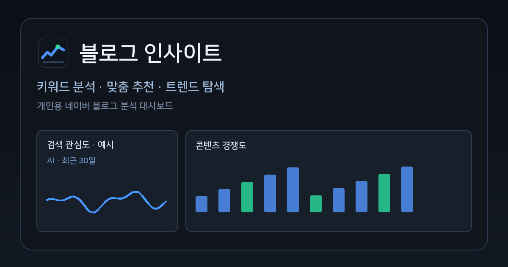

# 블로그 인사이트 · CMD 원클릭 GitHub Pages 배포



**Windows 10/11에서는 `github-bootstrap.cmd`를 더블클릭**하면 GitHub 저장소 생성과 Pages 자동 배포를 진행합니다. GitHub 계정 본인 확인을 위한 **공식 로그인 화면은 사용자가 직접 승인**해야 하며, 네이버 실시간 API 연결은 별도 절차입니다.

## 가장 쉬운 사용 방법 (처음 1회)

1. ZIP 전체를 원하는 폴더에 압축 해제합니다. ZIP 안에 `github-bootstrap.cmd`, `index.html`, `scripts/`, `.github/` 폴더가 모두 있어야 합니다.
2. `github-bootstrap.cmd`를 더블클릭합니다. 관리자가 차단했다면 출처를 확인한 후 실행하세요. 배치 파일과 PowerShell 스크립트의 내용을 직접 검토할 수 있습니다.
3. Git / GitHub CLI가 설치되어 있지 않으면 **Windows winget을 사용해 자동 설치를 시도**합니다. `winget`이 없는 PC에서는 [Git](https://git-scm.com/downloads/win) 및 [GitHub CLI](https://cli.github.com/)를 직접 설치한 후 다시 실행하세요.
4. 브라우저에서 GitHub 로그인을 승인합니다. 인증 비밀번호나 개인 액세스 토큰을 스크립트에 입력하지 않습니다.
5. 프로그램이 `blog-insight` 공개 저장소를 만들거나, 같은 저장소가 이미 있다면 원격 내용을 임시 폴더에 내려받고 프로젝트 변경분만 커밋합니다. **강제 push를 하지 않습니다.**
6. GitHub Pages를 Actions 배포 방식으로 설정하고 워크플로를 실행합니다. 배포 성공을 확인한 뒤 주소를 출력합니다.

기본 배포 주소는 **`https://GITHUB_ID.github.io/blog-insight/`** 입니다. Actions와 Pages 설정 권한, GitHub 장애, 조직 정책 등에 따라 자동 배포가 실패할 수 있으며, 이때 오류 원인과 재실행 방법을 출력합니다. **실제 계정에 로그인해 배포까지 검증한 상태는 아닙니다.**

```text
[CHECK] ... Git / GitHub CLI / GitHub 로그인
[OK] Repository created (또는 already exists)
[OK] Repository pushed
[OK] GitHub Pages enabled
[OK] Deployment workflow completed successfully
[OK] Web site : https://아이디.github.io/blog-insight/
```

**다시 배포하려면:** 수정한 다음 같은 `github-bootstrap.cmd`를 재실행하세요. 같은 이름의 저장소를 중복 생성하지 않습니다. ZIP 원본의 프로젝트 파일이 최신 내용으로 업로드됩니다. 기존 원격 저장소에만 존재하는 별도 파일은 자동으로 삭제하지 않습니다.

## 저장소 설정 변경

`github-bootstrap.cmd`의 상단에서 다음 변수를 수정할 수 있습니다.

```bat
set "REPO_NAME=blog-insight"
set "REPO_OWNER="
set "REPO_VISIBILITY=public"
set "AUTO_INSTALL_TOOLS=1"
set "CREATE_VERSION_TAG=1"
```

- `REPO_OWNER`가 비어 있으면 로그인한 GitHub 사용자 계정을 사용합니다. 조직 계정에 생성하려면 직접 입력하고 조직의 권한을 보유해야 합니다.
- `REPO_VISIBILITY=private`는 GitHub 요금제에 따라 Pages 기능을 사용할 수 없을 수도 있습니다. **공개 저장소라면 누구나 소스를 볼 수 있습니다.**
- `CREATE_VERSION_TAG=1`이면 최초로 성공적으로 배포한 커밋에 `v1.0.0` 태그를 생성합니다. 이미 존재하면 다시 만들지 않습니다.
- 같은 이름의 원격 저장소가 다른 웹사이트인 것으로 판단되면 무단 덮어쓰지 않고 중단합니다. 저장소 이름을 변경하세요.
- GitHub CLI 인증을 취소하거나 배포가 실패해도 비밀번호를 보관하지 않습니다. `gh auth status`와 `gh auth refresh -s workflow` 명령이 권한 문제 해결에 도움이 될 수 있습니다.

## 배포 파일 구조 / 보안

- `github-bootstrap.cmd`: 원클릭 진입점 (설정값 포함)
- `scripts/github-bootstrap.ps1`: 설치 확인, OAuth 로그인, 안전한 clone/commit/push, Pages 설정, 실행 결과 확인
- `.github/workflows/deploy.yml`: GitHub Pages에 **프런트엔드 파일만** 배포
- `index.html`, `styles.css`, `app.js`: 개인용 블로그 분석 화면
- `assets/`: favicon, PWA 아이콘, 카카오톡/소셜 미리보기 이미지
- `site.webmanifest`, `404.html`, `robots.txt`: 웹 앱 기본 설정과 오류 처리
- `worker/`: 실제 네이버 검색 API 요청을 위한 선택적 Cloudflare Worker 코드 (Pages 배포에서 제외)
- `tests/`: API 서버 코드 테스트 (Pages 배포에서 제외)
- `docs/웹서비스_제작_지침.txt`: 첨부한 웹서비스 제작 지침 원문 보관 (Pages 배포에서 제외)

**동작 원칙:** 이 저장소는 *사이트 배포용 소스*를 GitHub에 올립니다. GitHub Pages에 공개되는 파일은 Workflow의 `_site` 폴더에 복사된 정적 HTML/CSS/JS, 아이콘 및 메타데이터뿐입니다. `worker/`, `.github/`, `docs/`, API 비밀키는 방문자의 웹페이지에 공개하지 않지만, **저장소가 Public이면 소스 저장소에서는 누구나 볼 수 있습니다.** 따라서 민감정보를 저장소에 추가하지 마세요.

현재 사이트는 API 설정 전 **샘플 데이터를 명시적으로 표시**합니다. 실제 네이버 블로그 분석을 하려면 아래 Worker 연동 설명을 따라 별도로 네이버 API 자격 증명을 등록해야 합니다. GitHub Pages 단독으로는 공식 API 비밀키를 안전하게 보관할 수 없습니다.

## 수정 내역 — 경로 처리 오류 (2026-11-13)

이전 CMD 배포기의 `GetFullPath: Illegal characters in path` 문제를 수정했습니다. Windows 배치 파일이 PowerShell에 전달한 프로젝트 경로가 역슬래시(`\`)로 끝나면 일부 환경에서 뒤따르는 닫는 따옴표를 잘못 해석할 수 있었습니다. 이제 스크립트가 **자기 파일의 위치에서 프로젝트 폴더를 직접 찾도록** 변경하여 경로를 명령줄 인수로 전달하지 않습니다. 한글·공백·괄호를 포함한 압축 해제 폴더도 고려합니다.

- **기존 ZIP에서 재실행:** 수정 버전을 별도 폴더에 압축 해제해 `github-bootstrap.cmd`를 실행하세요. 이전 실패는 저장소 생성 전에 발생했으므로 계정 설정 변경이나 GitHub 토큰 재발급이 필요하지 않습니다.
- **기존 프로젝트만 교체:** 압축 해제한 새 버전의 `github-bootstrap.cmd`와 `scripts/github-bootstrap.ps1` **두 파일을 함께** 교체하면 됩니다.
- 경로 오류가 반복되면 `C:\blog-insight\` 등 짧은 폴더에 압축을 풀고 실행하거나, CMD에 표시되는 `[CHECK] Project folder:` 직후 오류 메시지를 전달해 주세요.

## 실패 시 복구

- `git.exe / gh.exe not found`: 설치 후 CMD를 완전히 종료하고 재실행하거나 자동 설치 옵션을 켭니다.
- `GitHub login failed`: `gh auth login`을 수동 실행한 뒤 다시 시도합니다.
- `Repository creation failed`: GitHub 계정 권한, 저장소 중복, 조직의 생성 권한을 확인합니다.
- `Git push rejected`: 다른 곳에서 먼저 업데이트한 경우입니다. **강제 push를 사용하지 말고** CMD를 재실행해 최신 내용을 복제하여 다시 커밋하도록 하세요.
- `GitHub Pages enabled` 단계 실패: 저장소 `Settings → Pages → Build and deployment`에서 **GitHub Actions**를 선택할 권한이 있는지 확인합니다.
- `Cannot trigger deploy.yml`: GitHub 저장소 `Actions`에서 워크플로 실행을 허용하고 `deploy.yml` 파일이 `main` 브랜치에 있는지 확인합니다.
- `Workflow failed`: `https://github.com/OWNER/REPO/actions`의 해당 실행 로그를 확인하세요. 코드나 권한 오류를 해결한 후 CMD를 재실행하면 됩니다.
- URL만 열리지 않음: Actions 성공 후에도 GitHub Pages CDN 전파가 지연될 수 있습니다. 잠시 후 브라우저에서 주소를 새로고침하세요.

## 아이콘, 사이트 미리보기와 PWA

`assets/favicon.svg`, favicon 16/32px 및 `favicon.ico`, Apple Touch Icon(180px), PWA 아이콘(192/512px), `site.webmanifest`, `assets/og-image.png`(1200×630), `assets/repository-preview.png`(1280×640), `404.html`을 제공합니다. CMD 배포 과정에서 GitHub 계정/저장소 이름에 맞는 Open Graph/Twitter 공유 메타 URL을 자동 지정합니다.

GitHub 저장소 자체의 대표 이미지는 `Settings → General → Social preview`에서 `assets/repository-preview.png`를 수동으로 올릴 수 있습니다. 저장소 대표 이미지는 Pages의 OG 이미지와 별도의 설정입니다. PWA 설치 가능 여부는 브라우저·보안 연결·기기 정책에 따라 달라집니다.

개인용 웹사이트이므로 `robots.txt`와 `<meta name="robots">`에 검색엔진 비색인을 요청해 두었습니다. **비색인 요청이 접근 차단을 의미하지 않습니다.**

## 로컬 테스트 / 라이브 데이터 연결

모든 사이트 파일이 정적이어서 **Node.js 설치나 빌드 없이 배포**됩니다. 로컬에서 브라우저로 `index.html`을 열면 샘플 UI를 볼 수 있습니다. 필요하다면 Python이 설치된 환경에서 `python -m http.server 8000` 실행 후 `http://localhost:8000/`을 사용할 수 있습니다.

사이트와 별도로 제공된 `worker/` 폴더에 대해서만 Node.js 및 Cloudflare Wrangler가 필요합니다. API 비밀키는 Cloudflare Secrets에 보관합니다.

## 라이선스 / 독립 프로젝트

MIT 라이선스(프로그램 코드). 블덱스 공식 서비스와 무관한 별개의 개인용 프로젝트로, 준최·최적 지수와 네이버 블로그 실제 순위를 재현하지 않습니다. 로고/아이콘은 직접 만든 기본 그래픽입니다.

---

## 기존 MVP 사용 설명 (수동 배포는 선택 사항)

**위 CMD 자동 배포가 기본 권장 방식입니다.** 아래 A절은 수동 업로드를 원할 때 참고하세요.

# 블로그 인사이트 — GitHub Pages 개인용 웹 대시보드

> 블덱스 화면 구성을 참고해 **독립적으로 개발한** 개인용 키워드 분석 첫 버전입니다. 블덱스와 제휴·연동 관계가 없습니다. 사이트 이름, 상표, 데이터, 등급 산정 알고리즘을 복제하지 않았습니다.

**설계:** 브라우저 UI는 GitHub Pages(HTML/CSS/JS)에서 실행합니다. 비밀 API 키를 사용하는 실시간 요청은 Cloudflare Worker가 네이버 공식 API에 대신 보냅니다. Worker 없이도 **샘플 데이터**로 5개 화면을 체험할 수 있습니다.

## A. GitHub Pages에 화면 올리기 (API 키 없이 즉시 가능)

1. [GitHub](https://github.com/new)에서 `blog-insight`라는 **Public** 저장소를 만들고 이 압축파일 안의 **모든 파일과 폴더**를 업로드하세요. `index.html`이 저장소 **루트**에 있어야 합니다.
2. 저장소의 `Settings → Pages → Build and deployment → Source`를 `Deploy from a branch`로 선택합니다.
3. `Branch: main`, `Folder: /(root)` 를 선택하고 `Save`를 누릅니다.
4. 사이트 주소는 보통 `https://내깃허브아이디.github.io/blog-insight/`입니다. 처음에는 전부 **샘플 모드**로 뜹니다.
5. GitHub Pages 설정 화면에서 실제 배포 URL을 확인하세요. (공개까지 수 분 걸릴 수 있습니다.)

**주의:** GitHub Pages 웹사이트는 일반적으로 누구나 URL을 알면 열 수 있습니다. GitHub 저장소를 Private으로 한다고 사이트도 자동으로 비공개가 되는 것은 아닙니다. 개인정보와 API 키를 저장소 파일에 쓰지 마세요.

## B. 네이버 검색·데이터랩 연결 (선택, 실시간 데이터)

GitHub Pages에는 Python/Node 등의 서버 기능이 없으므로 API Secret을 숨길 수 없습니다. 여기서는 [Cloudflare Workers](https://workers.cloudflare.com/)를 무료 사용량 내에서 실행하는 방법을 사용합니다.

### 1) 네이버 개발자센터

1. [네이버 개발자센터](https://developers.naver.com/apps/#/register)에서 애플리케이션을 등록합니다.
2. **검색**과 **데이터랩(검색어트렌드)** API를 사용하도록 추가합니다.
3. 발급된 **Client ID**, **Client Secret**은 본인만 알고 있어야 합니다. 공개 저장소나 브라우저 프런트엔드 파일에 적지 않습니다.

### 2) Worker 배포

Node.js LTS가 설치된 PC에서 터미널을 열고 압축 해제한 프로젝트 폴더로 이동한 뒤 다음을 실행합니다.

```bash
cd worker
npm install
npx wrangler login
```

`worker/wrangler.toml`에서 다음 한 줄을 본인 GitHub Pages **origin**으로 바꿉니다. 주소 끝의 `/blog-insight/` 같은 경로는 적지 않습니다.

```toml
ALLOWED_ORIGIN = "https://내깃허브아이디.github.io"
```

비밀 정보를 Cloudflare 환경 변수로 등록합니다. 각각 프롬프트가 나오면 값을 입력하세요.

```bash
npx wrangler secret put NAVER_CLIENT_ID
npx wrangler secret put NAVER_CLIENT_SECRET
npx wrangler secret put ACCESS_TOKEN
npx wrangler deploy
```

`ACCESS_TOKEN`은 네이버 비밀키가 아니라 **내 개인 사이트가 Worker에 접근할 때 사용할 길고 임의적인 비밀번호**입니다. 최소 24자 이상 무작위 문자열을 권장합니다. Worker의 주소(`https://my-blog-insight-api.계정.workers.dev`)를 기록합니다.

> Wrangler 버전에 따라 최초 Secret 등록 시 Worker가 먼저 생성되어야 할 수 있습니다. 이 경우 `npx wrangler deploy`를 먼저 실행한 다음 Secret을 등록하면 됩니다.

### 3) 사이트에서 접속 설정

1. GitHub Pages 사이트 오른쪽 위 `⚙`를 누릅니다.
2. 방금 배포한 **Worker 주소(HTTPS)** 와 **ACCESS_TOKEN** 값을 입력합니다.
3. `연결 적용`을 누릅니다. 키워드를 검색하면 네이버 API 결과를 읽습니다.

Worker 주소만 브라우저의 `localStorage`에 보관되고, `ACCESS_TOKEN`은 `sessionStorage`에 보관되어 해당 탭의 세션 종료 시 사라집니다. 브라우저/확장 프로그램에 악성 코드가 있으면 토큰을 읽을 수 있으므로 보안에 유의하세요. **접속 토큰은 GitHub에 업로드하지 않습니다.**

## 기능 및 데이터 정확성

| 화면 | 샘플 모드 | API 연결 모드 | 유의점 |
|---|---|---|---|
| 키워드 분석 | 임의 예시 숫자·목록·그래프 | 네이버 블로그 검색 API + 데이터랩 | 검색 API 순위는 실제 네이버 통합검색/블로그 탭 노출 순위와 다를 수 있음 |
| 맞춤 키워드 | 예시 관심도 및 경쟁 결과 | 최대 5개 관심 키워드의 검색 결과 수·트렌드 비교 | 점수는 투명한 참고용 규칙. 개인 블로그 등급·지수를 반영하지 않음 |
| 뜨는 키워드 | 예시 5개 키워드 | 입력 키워드의 30일 상대지수 | 데이터랩은 *절대 월간 검색량*을 주지 않음 |
| 블로그 급상승 | 예시 후보 상승률 | 직접 입력한 키워드의 최근/이전 7일 상대지수 평균 변화 | 전국 실시간 급상승 검색어 자동 수집 아님 |
| 내 블로그 | 예시 최근 글 | 공개 RSS 최근 글과 제목 키워드 | 구독자, 방문자, 블덱스 지수 제공 불가 |

**맞춤 추천 참고점수**는 동일한 비교 묶음 내 상대적 지표입니다.

- 최근 7일 평균 상대 관심도 × 0.45
- 비교 묶음에서 검색 결과 수가 적은 정도 × 0.40
- 최근 7일 대비 관심도 변화로 계산한 간단한 모멘텀 × 0.15

이는 블로그 실력이나 실제 상위노출 가능성의 확률이 아니며, 알고리즘의 통계적 유효성이 검증된 것이 아닙니다.

**절대 검색량 / 월간 발행량 / 블로그 수준(준최 등) / 포털 검색 섹션 배치 / 내 블로그 실제 검색 노출 순위 / 네이버·구글 전국 실시간 순위:** 이 첫 버전에는 구현되지 않았습니다. 네이버 검색광고 API의 월간 검색수 연결, 별도의 합법적인 순위 추적 수집을 추후 확장할 수 있습니다. 실제 원본 서비스와 일치하는 정보가 아닙니다.

## 테스트 및 구조

```bash
node --check app.js
node --check worker/src/index.js
node --test tests/*.test.mjs
```

- `index.html`, `styles.css`, `app.js`: GitHub Pages 프런트엔드 (별도 빌드 불필요)
- `worker/src/index.js`: Cloudflare Worker (API 서버)
- `worker/wrangler.toml`: Cloudflare 배포 구성 (본인 Pages origin 수정 필수)
- `tests/worker.test.mjs`: Worker 요청·응답 모의 테스트
- `.nojekyll`: Pages 기본 Jekyll 처리 방지

## API 출처 / 참고

- [GitHub Pages 공식 문서](https://docs.github.com/en/pages/getting-started-with-github-pages/creating-a-github-pages-site)
- [네이버 블로그 검색 API](https://developers.naver.com/docs/serviceapi/search/blog/blog.md) — 검색 결과 수 및 글 목록
- [네이버 데이터랩 API](https://developers.naver.com/docs/serviceapi/datalab/search/search.md) — 기간별 검색 관심도 상대지수
- [네이버 블로그 RSS 관련 공지](https://developers.naver.com/notice/article/27228)
- [Cloudflare Workers 제한](https://developers.cloudflare.com/workers/platform/limits/)

### 보안 참고

Cloudflare Worker는 네이버 인증 정보를 Server Secret으로 보관하며 브라우저에 돌려주지 않습니다. Origin 허용 목록 및 ACCESS_TOKEN으로 임의 접근을 제한하지만, 본격적인 다중 사용자 로그인 서비스용 보안·속도 제한 기능까지 제공하지는 않습니다. 본인만 쓰는 용도로 구성했고 서비스 운영 시 접근 제어·요청 속도 제한·모니터링 등을 추가하는 것이 바람직합니다.
